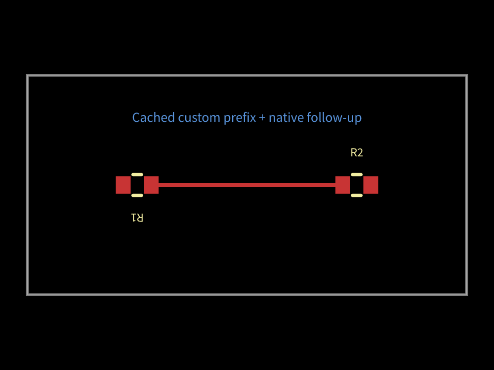

# Cached custom routing followed by native routing

The generated control board is fully routed by the built-in router. The new
regressions request an explicit follow-up after a cached custom prefix. Base
ignores that option, emits only one stage, and never attempts the remaining
route. They intentionally fail; the stacked fix supplies the missing opt-in.

Coordinates are PCB world mm: +X right, +Y up, +Z above; right handed. The
custom synthetic prefix is one wire, and the follow-up must preserve it. No
AM3352 inputs or saved board routes are included. Each PR must report paired
fixture completion, stage/call counts, failures, elapsed time and inspected
visuals before merge.
