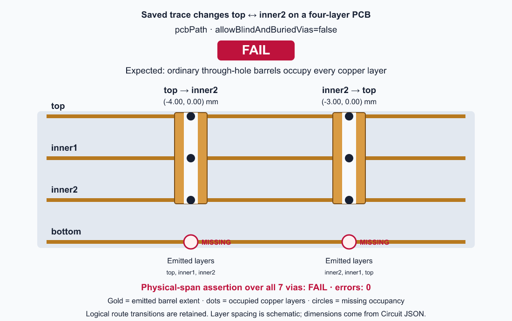

# Manual saved-path via physical span (#4526)

Related issue: https://github.com/tscircuit/core/issues/4526

The signal uses `top → inner2 → top` on a four-layer PCB. With blind/buried
vias disabled, ordinary drilled barrels must occupy `top`, `inner1`, `inner2`,
and `bottom`. Logical `from_layer` / `to_layer` fields describe the signal
transition; they do not limit the physical barrel's `layers`.

## Reproduction PR (intentionally failing)

Upstream source commit: `afc31cf3ff71deba0c30e4365923544608b93094`.
Run with Bun 1.3.14, without dependency patches:

```sh
bun install
VIA_SPAN_EVIDENCE_DIR=docs/issue4526/failing bun test tests/repros/repro4526-manual-via-physical-span.test.tsx
# Expected exit 1: 10 pass, 8 fail. Save stdout/stderr as failing/bun-test.log.
bun run scripts/render-manual-via-span-evidence.ts docs/issue4526/failing
```

The parameterized regression covers both `pcbPath` and `pcbPaths`, 2-, 4-,
and 10-layer stacks, and omitted/false/true `allowBlindAndBuriedVias`.
The paths exercise forward/reverse blind, buried, and outer-layer transitions.
Two-layer and blind/buried-enabled cases pass. The eight failing cases are
the multilayer omitted/false cases: physical occupancy omits required layers.
All cases first pass checks for no emitted errors, via counts/diameters,
logical transitions, and wire-layer preservation. Occupancy comparisons are
independent of array direction, so a reversed full-span via is a valid control.

## Actual-run visual evidence




These are annotated cross-sections derived from the actual emitted Circuit JSON,
not a proposed geometry. The first two of the seven emitted vias are shown.
The four copper layers, occupied-layer dots, barrel extent, logical transitions,
world coordinates, and missing bottom occupancy are visible. Layer spacing is
schematic; barrel/hole widths use emitted diameters. The header is centered.
FAIL/PASS is set only by the observed behavioral assertions, including setup.

`failing/observations.json` records all 18 cases and their expected/actual spans.
`failing/pcbPath.json` and `failing/pcbPaths.json` preserve the full emitted JSON
for the pictured cases. `failing/bun-test.log` records the actual assertion diffs.
`failing/environment.json` identifies the local dependency versions.

Failure artifacts live here, separate from expected snapshot baselines. The
test only compares a visual baseline after its behavioral assertions pass;
this PR contains no baseline captured from buggy output and no implementation fix.

## Stack and merge order

The fix PR branches from this reproduction branch and initially targets it.
Review the reproduction first, then the isolated fix. Merge the reproduction,
retarget the fix to `main`, then merge the fix. The reproduction alone is
intentionally red; merge the pair together in that order.
