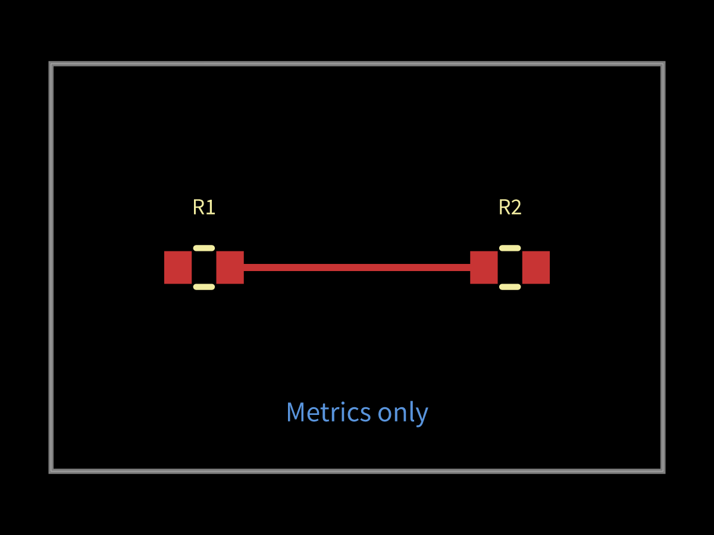

# Avoid rendering unused autorouter progress graphics

Native CLI builds consume progress metrics, yet Core calls solver.preview() on
every tick. For a dense mesh that allocates large graphic frames repeatedly.
The reproduction routes a generated two-resistor PCB and observes preview calls
without reading graphics. The stacked fix makes frames lazy and memoized,
including forwarding through Group. Consumers that read or serialize graphics
still receive a frame. No routing algorithm or geometry changes.

Every PR must report paired benchmark effects before merge. The comparison
checks native completion and route hashes, metrics-only preview calls, and
interactive consumers with repeated reads. This tiny fixture establishes work
avoidance, not an AM3352 routing speed claim.

Local fixed-set result: both native consumers route one trace with zero errors
and identical geometry hash before/after. Metrics-only preview calls fall 1→0;
interactive calls remain 1, with memoized repeated reads. Nine existing native
routing controls pass with 97 assertions. The two new tests pass with 11
assertions. Tiny-fixture medians are included in local JSON; shared-machine
timings do not establish whole-board speed. Blacksmith runs the paired native
fixtures and controls on each PR, with completion and geometry gates.
