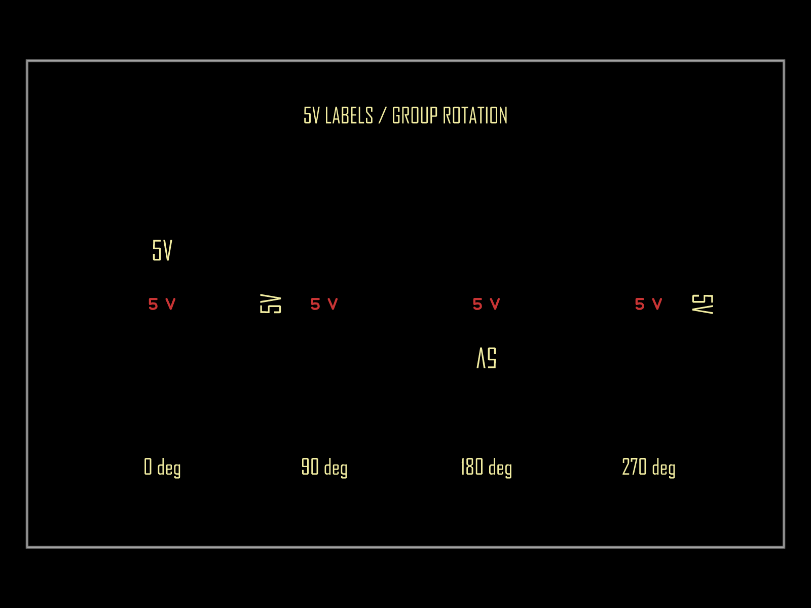
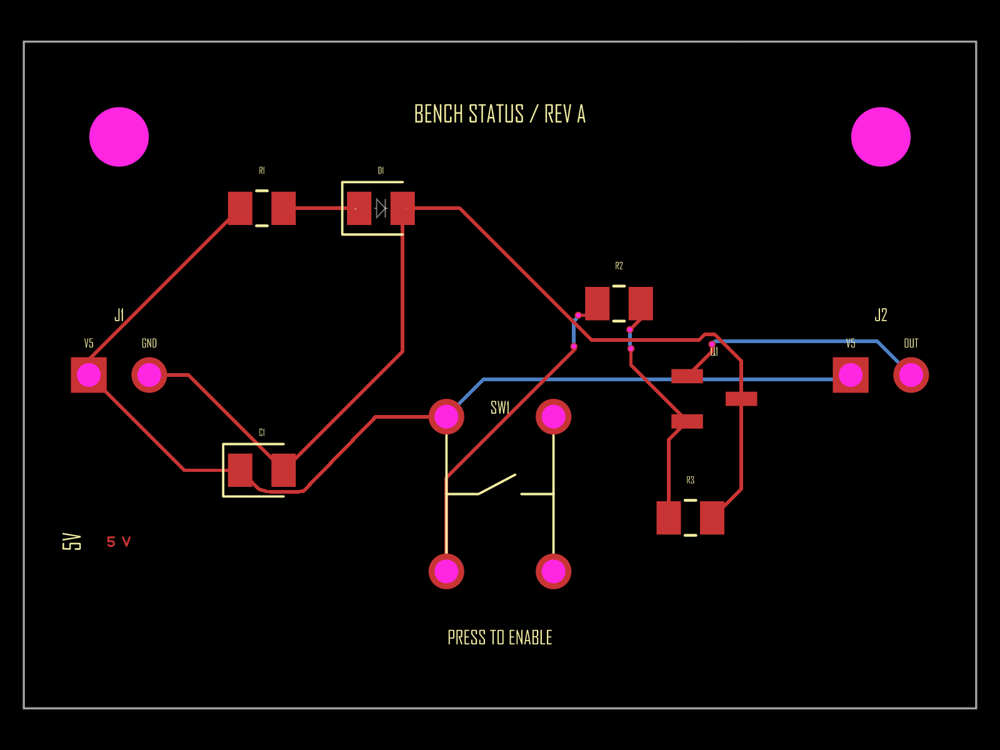

# Copper supply labels ignore their group's rotation

## Intent

Build a practical 5 V Bench Supply Status Indicator, then reduce the incorrect copper-label orientation to a small source-driven reproduction. This PR contains tests and evidence only.

- [Bench Supply Status Indicator — full board](https://tscircuit.com/editor?&snippet_type=board#data:application/gzip;base64,H4sIADDX9GoAA62WbW/aMBDHv4qVV620hkBhZVNBosBWIUTXQNmmZS9MYkjUYEeJo9IhvvvONjHhITxIfYPsw/f/3Z19dpZGQD2yMHmyML4aZBGxmCOPTHEacnR1jRpNdOVQhO4nDMceegs87jcco2rN546BfBLMfA7zSl3OccpZzFJOYrCJyU3IXBw6RlNogEoUUJ9gj8SI4jmBRb0yuIG1zVLKG8vKCibcFYiKWatK0SljPIoD+NsxYGXM3irKp48nJEwayz+OMa45xifkGN8HHcf4CyLu5FdjeVP+LIe/G0trhRLXF7Y7OQITsEpZXDFJggRiz8KyRVjKiKkrLOXXnVCsugVQTQKAIil9YatmpNscKSReBukIiMtCJqo1iwmhRxG1fUL5EMHFEXaDXDJtyVHWLBvLot/OTGidx1ZG8KfmRWniT1LOGc2Aw5+CuLVveo0mbPQhMaWvNmlHfm9rxO5vbU3VvDu6ObpwUCUFUoNToNu9M2BZR0F1nRKcux3STX6LeIzpNuxZVIy/R2JMo92DkDBeEdEozBeNUfsPJsXb3Zi9Zls3zgc129PLKNdsB3oN6rF/PCF3l6BpzOaAMHtl1EQm6Mv8mciecFMQTnqIwLSHbPwiF/tiiPbQELMjTZgyjxT7qUUu5r5adl587Yvj0x7nFwGa8lLKxmVTBruSUymqXrZm4/YslSY4OVI8+3Y3wMvczq+FkiXzgMNTdaEXXNghcaF1dZC9fLpFpzZftoLi+ywkWas+inVeABP1mEKDyv7ce9jEPX1YQURTqFAgkATha+KKp4iTBUfiB1wfuoP2IxqOWqOXISohuztGLXlXUD4M/hHQ0GIwOiH2w+4Oh2j0hLqD1kO/u6VjmZsrdEtqBl8VkX5e0igK3/tkRqh3qCTiiYeRzTjmAaNwYVqrtZB4HlkUkTgfUW18OJlcYQqzKfLNf1yUZPRydl+S31EwvnaosfoPSXurHH4JAAA=)
- [Reduced rotation board](https://tscircuit.com/editor?&snippet_type=board#data:application/gzip;base64,H4sIAHTX9GoAA4VSYU/CMBD9K5d+2hTYIFHAMBKMxpgQMYBG4/wwtmM0bO2ylThd9t89uiFCIn5oc+9y7+7dawvGRYB5S2U5u2KYJzJVEODS20QKDBOcIRiuABgspJcG8MEDtXJc1unFsctghTxcKcLtCqdyo7gIb3jmLSIMhlsmcTMerTM/RRQKcwXbizgXzzAeXd+OZ2DB3XTy9AjTyXw0v588UKfEX7w6RbeEpRRqxr/QKexWrwSr7lm82Q3o02n36Op07fdW7CWGQbypVJ7iUjTAl9EmFvsltJiQRCYgvJhaumyMIYqABp5vR+6oJazx0ykOMgRenKLZp8qqL5zBpU6TUFsHu+JDZq1YD/dlkmB66AIN3y/Z3q940rpjUiWj85s9sPSqNTbN8rRz6WnbjoRof3aUstL1g8ki0hdg6LJ/fGtS9McL14IHlv55lDRdwcpvpgxFkbACAAA=)
- [Full board source](./bench-supply-status-indicator.tsx)

The editor links contain the source itself. Saving a registry package under the account was blocked by an expired tscircuit session; no saved registry package is claimed.

## Observed behavior

| Parent group rotation | Copper label orientation | Expected orientation |
| --- | --- | --- |
| 0° | 0° | 0° |
| 90° | 0° | 90° |
| 180° | 0° | 180° |
| 270° | 0° | 270° |

The yellow silkscreen labels in the same groups rotate correctly. Red copper labels remain horizontal.

## Reproduce

Tested against upstream core commit fc7c379e7376db75f8d61fec5447c8022ede6526, package version 0.0.2344, Bun 1.4.4 on Windows. Renderer circuit-to-svg 0.0.457; props 0.0.724; circuit-json 0.0.548; math-utils 0.0.39.

1. Install dependencies with bun install.
2. Run bun test tests/repros/copper-text-group-rotation.test.tsx tests/repros/copper-text-group-rotation-expected.test.tsx.
3. Inspect tests/repros/__snapshots__/copper-text-group-rotation-pcb.snap.svg.
4. To see the behavioral failure directly, temporarily change test.failing to test in copper-text-group-rotation-expected.test.tsx and run that file. Expected normalized angles are [0, 90, 180, 270]; actual angles are [0, 0, 0, 0].

The snapshot test passes independently. The desired-behavior test is explicitly marked as an expected failure; it is not a fix. The existing copper-text rendering test was also run: three targeted tests passed, including the one expected failure. Formatting/lint checks passed for the three added TSX files. The full core suite was not run.

## Source of the defect

lib/components/primitive-components/CopperText.ts emits ccw_rotation from props.pcbRotation. It obtains the global anchor position but does not incorporate the parent's global orientation. No production code is changed here.

Related work: [circuit-json-util PR #144](https://github.com/tscircuit/circuit-json-util/pull/144) fixes rotation in transformPCBElement. This repro exercises core's TSX group-to-Circuit-JSON authoring path, before an external Circuit JSON transform, and does not rely on that helper.

## Real board

The 40 × 28 mm board has a two-pin 5 V input, green power LED and resistor, 100 nF decoupling, momentary button, NPN output stage with base resistor and pulldown, output header, and mounting holes. The rotated supply legend is where the defect was encountered.

Local render completed with 9 electrical components, 13 routed PCB traces, and no core error elements after correcting a Q1/J2 courtyard overlap. This is a development board, not a fabrication sign-off; no full manufacturing or electrical simulation validation is claimed.

## Evidence provenance

The committed SVG is emitted by the repository's toMatchPcbSnapshot matcher from the real core-generated Circuit JSON. repro-pcb.png is a rasterization of that exact SVG using resvg. board-pcb.png is rendered from the complete board's actual Circuit JSON with circuit-to-svg. These are actual software renders, with no image-generation model, hand-drawn replacement, or fabricated before/after image.

## Duplicate search

Searched open and closed issues and PRs across the tscircuit organization for coppertext, copper text, copper_text, copper label, group, parent, rotation, and transform combinations on 2026-11-11. No matching report for this core authoring path was found. Related [PR #144](https://github.com/tscircuit/circuit-json-util/pull/144) and the [copper-text routing-obstacle PR #5172](https://github.com/tscircuit/core/pull/5172) were reviewed and address different paths. This search cannot prove that no other report exists.
