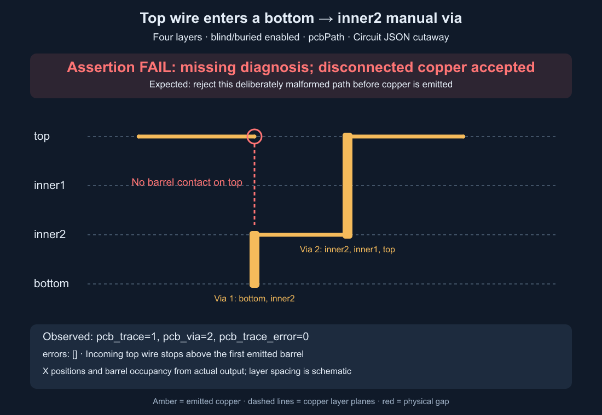

# Disconnected manual via transition

Bug report: https://github.com/tscircuit/core/issues/4532

Upstream: `afc31cf3ff71deba0c30e4365923544608b93094` (`0.0.2129`). Bun 1.3.14,
macOS arm64. Core owns manual route construction and via materialization.

With blind/buried vias enabled on a four-layer board, a top wire enters a
`bottom → inner2` via. The emitted barrel occupies only `bottom, inner2`.
The input is intentionally invalid and should be diagnosed/rejected, never
silently treated as connected copper. This is separate from #4526's
through-hole span policy when blind/buried vias are disabled.

## Reproduce

```sh
bun install
bun test tests/repros/repro-disconnected-manual-via.test.tsx tests/repros/manual-via-physical-contact-controls.test.tsx
bun run scripts/repros/capture-manual-via-transition.ts
```

The capture script writes to ignored `debug-output/manual-via-transition` by
default. Pass an explicit output directory to retain a run. Filenames and
FAIL/PASS labels come from observed diagnosis and emission counts, not a
manually supplied expected status. It exits 1 if invalid paths are accepted.

## Actual upstream failure



The image is an X/layer cutaway derived from emitted Circuit JSON, with
schematic layer spacing. All fixture points have Y=0. Amber copper shows the
top wire stopping above a barrel that never reaches top; the red annotation
marks the missing physical contact. The image for `pcbPaths` is
[fail-pcbPaths.png](fail-pcbPaths.png).

- [Actual test output and assertion diff](fail-tests.txt): **1 pass, 1 fail**;
  the failure is missing diagnosis and emitted invalid copper, not setup.
- [Observed results](fail-results.json): four invalid cases (top and inner1,
  both APIs) are undiagnosed and emit one trace plus two or three vias.
- `fail-*-disconnected_*.json` contains the complete Circuit JSON from each run.
- Ten valid controls pass: matched/implicit logical fromLayer, complete
  through barrels with different logical fromLayer, and contact at an
  intermediate occupied layer. Full-span controls run with blind/buried vias
  enabled and disabled.

FAIL captures are evidence, **not expected snapshot baselines**. The regression
checks rejection before writing/comparing any expected visual snapshot.
The fix must leave the bad input intact and produce a diagnosis with no
invalid trace or via. It must preserve physically valid contacts.

## Stack

PR 1 contains only the intentionally failing regression, valid controls, and
observed failure evidence. PR 2 branches from PR 1 and targets its branch so
review shows only the fix and passing evidence. Merge PR 1 first, then retarget
PR 2 to main. Neither PR is merged by this task.
