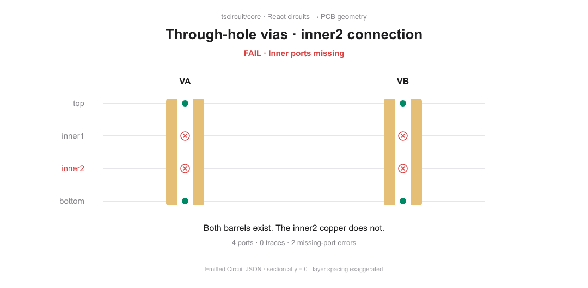

# Through-hole via layer ports

Bug report: https://github.com/tscircuit/core/issues/4530

Reproduction PR: https://github.com/tscircuit/core/pull/4534

On upstream `afc31cf3ff71deba0c30e4365923544608b93094` (core 0.0.2129), standalone via components emit full four-layer barrels but initialize only top/bottom ports. A requested `VA.inner2` → `VB.inner2` path emits no copper. Explicit `layers` does not avoid the failure.

## Reproduce

```sh
bun install
VIA_PORT_EVIDENCE_DIR=/tmp/via-port-evidence bun test tests/repros/repro-via-layer-ports-matrix.test.tsx tests/repros/repro-via-inner2-ports.test.tsx --timeout 30000
```

The matrix covers 208 combinations: supported 2/4/6/8/10-layer stacks, forward/reverse through spans, bounded blind/buried spans, each occupied trace layer, explicit layer lists, and vias nested in a subcircuit. It checks exact barrel spans, dimensions, named source/PCB ports, attached port IDs and positions, source endpoints, and emitted wire layer/width/coordinates/length. Expectations come from independently constructed board stacks.

The focused reproduction uses default via endpoints and the original two-selector `pcbPath`. It checks the full physical span, absence of missing-port errors, and emitted inner2 copper. Optional evidence files record the emitted Circuit JSON and actual assertion status in `finally`, including on failure.

## Failing evidence



The annotated layer section is derived from emitted Circuit JSON: every barrel uses its recorded `layers`, position and diameters; each port marker uses the via's emitted `pcb_port_ids`; copper is drawn only from emitted nonzero wire segments. Layer separation is exaggerated. Missing-port crosses denote absent records, not removed barrels. The status comes from the actual Bun assertions.

`failure/` contains actual-run output, **not expected snapshots**. Upstream reports 12/208 matrix cases passing; both test files fail for the intended missing-port behavior. No production code is changed in the reproduction PR. The expected PCB snapshot is created only after the fix passes its behavioral assertions.

A separate pre-existing checks diagnostic reports dangling endpoints even for a valid two-layer top-to-top via control. The regression asserts missing-port errors and real copper/port attachment rather than hiding that diagnostic or requiring unrelated DRC changes. Raw emitted JSON preserves all diagnostics.

Merge order: reproduction PR into main, then retarget the dependent fix PR to main and merge it. The reproduction PR intentionally fails until the dependent fix lands.
