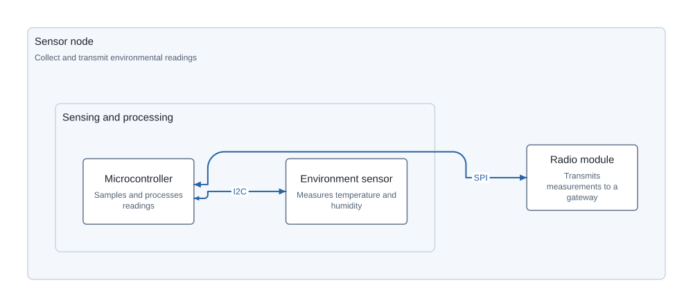
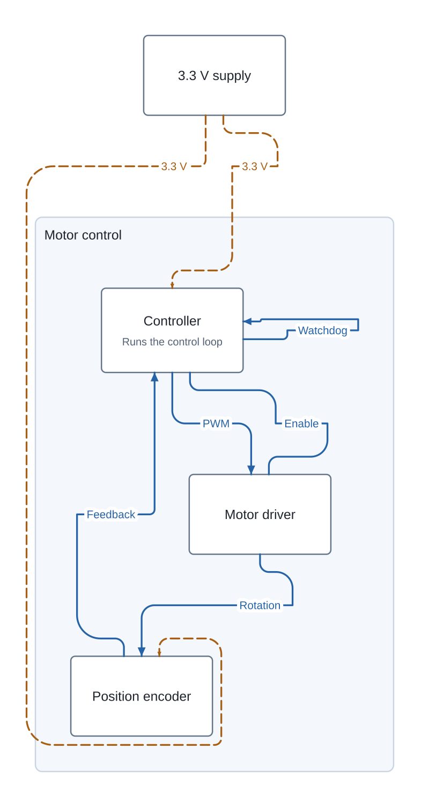

# System block diagrams

Import `systemblock` from `@tscircuit/core` to describe a system overview in TSX.
Pages work independently or alongside physical components in a board/subcircuit.
Core emits resolved `system_block_*` Circuit JSON records for SVG viewers.

```tsx
import { Circuit, systemblock } from "@tscircuit/core"
import { convertCircuitJsonToSystemSvg } from "circuit-to-svg"

const circuit = new Circuit()
circuit.add(
  <systemblock.page name="overview" displayName="Wireless sensor node">
    <systemblock.group name="processing" displayName="Sensing and processing">
      <systemblock.component name="sensor" displayName="Environment sensor"
        description="Measures temperature and humidity" />
      <systemblock.component name="mcu" displayName="Microcontroller"
        description="Processes readings" />
    </systemblock.group>
    <systemblock.component name="radio" displayName="Radio module"
      description="Transmits measurements" />
    <systemblock.connection from="sensor" to="mcu" label="I2C" direction="both" />
    <systemblock.connection from="mcu" to="radio" label="SPI" direction="both" />
  </systemblock.page>,
)
await circuit.renderUntilSettled()
const svg = convertCircuitJsonToSystemSvg(circuit.getCircuitJson())
```



## Layout and connections

Core uses [Dagre](https://github.com/dagrejs/dagre) synchronously to lay out each
subsystem's contents, then arranges the subsystem boxes. This keeps unrelated
subsystems from stretching each other's internal ranks. Bidirectional interfaces
favor the more connected endpoint for ranking, while emitted routes always retain
the declared from/to order. Block dimensions are derived from their text.

A rectilinear visibility-grid router avoids component interiors, group headings,
and other connection labels. Endpoints initially face their label slot or target
and are ordered by approach angle. A bounded optimization pass swaps neighboring
landing slots, including slots across block corners, and reroutes the affected
connections. It accepts swaps only when the complete diagram's score improves:
crossings, shared segments, and crowded parallel runs carry larger penalties than
bends or extra length. The visibility grid includes lanes 3 mm from existing
wires so adjacent routes can run separately. A final rerouting sweep shortens
remaining detours when it improves the same score.

Labels occupy reserved horizontal slots; overlapping slots are moved before
routing. Pages expand to contain outer detours. Routing is deterministic and has
no browser or DOM requirement. Optimization tries at most 64 swaps over four
passes, followed by one rerouting sweep. Crossings and tighter spacing can still
occur on dense graphs; these penalties are not hard routing guarantees.

Page `direction` is `right` (default), `left`, `down`, or `up`. Geometry is in
diagram millimeters, centered on the page with +X right and +Y up. Nested group
centers and route points are absolute page coordinates. PCB positions and sizes
do not affect the system layout. The SVG renderer receives resolved geometry;
no additional graph layout is necessary.

Core rounds bends with circle-derived cubic Bézier segments, targeting a radius
of 12 diagram mm. It removes redundant collinear waypoints and reduces the radius
when adjacent segments are short or rounding would intersect a block, group
heading, or label. Corners with no clearance and exact reversals remain angular.
Same-block connections use parallel stems and a semicircular return, represented
by two quarter-circle cubics, when the existing attachments, bounds, and clearance
allow it. Otherwise they retain ordinary corner rounding. The return is checked
against blocks, group headings, and labels, including labels inside the loop.

Rounding follows endpoint optimization and orthogonal routing. It preserves the
chosen attachment points and label positions, and also checks neighboring wires
so curved corners do not reintroduce crossings or crowd parallel routes.

The emitted route stores absolute `cubic_bezier_control_points` on each curved
segment's endpoint. Arc pieces span at most 90 degrees, with matching tangent
directions at joins and a maximum radial error of about 0.0273%. Rounded geometry
stays within the original corner bounds, preserving the resolved page bounds.
Use `circuit-json` 0.0.544 and `circuit-to-svg` 0.0.456 or later to retain and render
these controls. No additional TSX props are required.

Connections use component names in `from` and `to`. Their `direction` is
`forward` (default), `both`, or `none`. Parallel connections, feedback cycles,
self-loops, and disconnected blocks are supported. The props API's `kind`
(`signal` by default or `power`) becomes the required `is_signal` and `is_power`
booleans in Circuit JSON. Every supplied label has a resolved
`label_anchor_center`. Connections do not create electrical traces or nets.

### Connection colors and line patterns

```tsx
<systemblock.connection from="mcu" to="display" label="I2C"
  direction="both" color="#16856b" lineStyle="solid" />
<systemblock.connection from="debug" to="mcu" label="Recovery"
  color="#64748b" lineStyle="dotted" />
```

`color` accepts a trimmed `#RGB` or `#RRGGBB` string, preserved without conversion,
and overrides the renderer's theme for the connection stroke, arrows, and label.
`lineStyle` accepts `solid`, `dashed`, or `dotted`, overriding the pattern selected
by `kind`. These are independent, optional props with no aliases or conflicts.
They emit `color` and `line_style` in Circuit JSON. Omit them to keep the existing
signal/power styles; existing TSX and Circuit JSON need no migration. Labels use
a background-colored halo so nearby wires do not obscure their text.



## Names, grouping, and PCB associations

Page names must be unique within the circuit. Block and group names share one
namespace per page, including nested groups. Connection names are optional and
unique among named connections in a page. Nested pages and non-system children
inside a page/group are invalid. Groups can contain connections as well as
components and other groups.

Components and groups accept optional `pcbComponentName`, `pcbComponentNames`,
and `pcbSubcircuitName` props. For example, inside a board:

```tsx
<systemblock.page name="power-overview">
  <systemblock.group name="power" displayName="Power supply"
    pcbSubcircuitName="power">
    <systemblock.component name="filter" displayName="Supply filtering"
      pcbComponentNames={["R1", "C1"]} pcbSubcircuitName="power" />
  </systemblock.group>
</systemblock.page>
```

Component names are literal reference designators, resolved in the page's
owning subcircuit unless `pcbSubcircuitName` selects another named subcircuit.
Singular and plural component props are mutually exclusive; repeated names in
the plural form resolve to a union. `pcbSubcircuitName` alone associates the
whole PCB group. Parent group associations are not inherited by child blocks.
Missing or ambiguous PCB targets throw readable errors. Referenced PCB output
must exist, so these associations require PCB rendering to be enabled.

The records carry resolved `pcb_component_ids` and/or `pcb_group_id` for viewer
navigation. System names are independent of physical component names.

## Examples and validation

The [TSX fixtures](../tests/features/system-blocks/) include all four directions,
nested groups, power fanout, feedback, PCB references, multiple pages, empty
groups/pages, long text, and page updates. Snapshots use `circuit-to-svg` 0.0.456
or later. Tests also validate the emitted Circuit JSON and check that routes
terminate on block boundaries, stay within the resolved page bounds, and never
pass through component interiors. The RVBoy console and power fixtures exercise
dense two-way interfaces and cross-subsystem power fanout. Independent geometry
checks require no wire intersections and at least 3 mm between overlapping
parallel runs on both RVBoy pages; the console test also locks down the CPU
landing order for the USB, audio, and debug connections.
