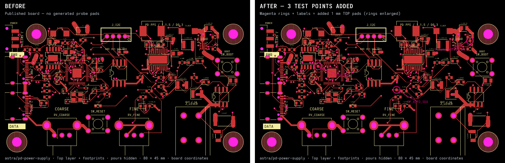

# Generated test-point phase (prototype)

Use one final reroute phase to add one exposed circular pad per selected routed trace:

```tsx
<autoroutingphase
  name="Probe access"
  reroute
  connections={["U1.pin3", "U1.pin4"]}
  addTestPoints
  testPointLayer="bottom"
  testPointDiameter="1mm"
  testPointClearance="0.2mm"
  testPointMinProbeSpacing="2.54mm"
  testPointMaxDetour="1mm"
/>
```

The short form `<autoroutingphase reroute addTestPoints testPointMaxDetour="10mm" />` targets all routed traces. Defaults are bottom layer, 1 mm diameter, 0.2 mm clearance, 2.54 mm probe spacing, and 1 mm maximum detour. Selectors use the existing connection-selection rules. Every selected route must have a legal location on the requested outer layer; an impossible request fails the phase. The prototype does not add vias to bring inner-layer-only signals out to a surface. Fixed/manual routes are rejected. Request multiple pads in the same final phase so center spacing is checked across the whole set. Names are generated as `TP_AUTO_<phase>_<ordinal>` and collisions are rejected.

Pads have source test-point components, source connectivity, PCB components/ports and circular SMT copper with `is_covered_with_solder_mask: false`. No solder paste is generated. Component envelopes are included as probe-access keepouts. The phase must be last so later rerouting cannot detach its pads. Probe barrel/fixture access and manufacture-specific mask/finish rules still require a separate fixture design step.

The reproducible board prototype uses [astra/pd-power-supply](https://tscircuit.com/astra/pd-power-supply), release `57387f49-bd91-4277-8a82-706b1575c5ed`. The gzip fixture is the full published `dist/board/circuit.json`; the SRJ fixture comes from the test-point-rerouter repository's `scripts/prepare-test-point-board.ts`. Run `bun scripts/prototype-test-point-board.ts <directory>` to produce annotated before/after board images, updated Circuit JSON, a DRC finding comparison and probe targets. Targets are board-world points in mm (+X right, +Y up, +Z above, right-handed); bottom coordinates are not mirrored. A fixture generator should perform that transform explicitly.

The prototype places three 1 mm top pads for SDA, SCL and OUTPUT_EN with 2.54 mm minimum center spacing. SDA and OUTPUT_EN use top-accessible branches of the same original nets; clearance and detour limits remain unchanged. Full routing and placement checks plus explicit 0.2 mm pad/pad, pad/trace and via/pad clearance checks introduce no findings. The comparison retains referenced objects and physical geometry instead of relying on counts alone. Existing board findings remain.

The merged rerouter is consumed as a pinned GitHub source package and bundled into core. The phase API uses published `@tscircuit/props` version `0.0.714` or later, including the `testPoint`-prefixed options from [props #963](https://github.com/tscircuit/props/pull/963).



The visualization renders the top layer, including component pads and silkscreen. Magenta review overlays identify the generated top-side pads in board coordinates. Filled copper pours are hidden only in the review image, and enlarged magenta rings label the three new pads; emitted manufacturing geometry and DRC inputs retain the complete board.
