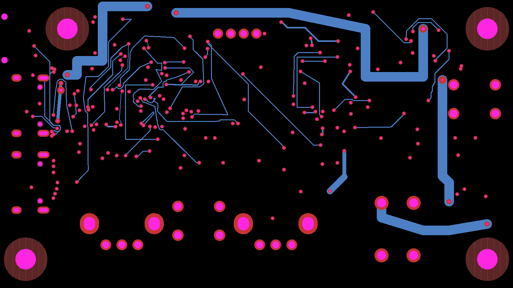
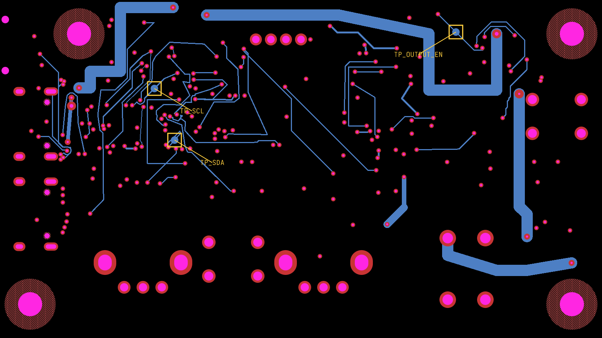

# Generated test-point phase (prototype)

Use one final reroute phase to add one exposed circular pad per selected routed trace:

```tsx
<autoroutingphase
  name="Probe access"
  reroute
  connections={["U1.pin3", "U1.pin4"]}
  pcbTestPoints={{
    layer: "bottom",
    diameter: "1mm",
    clearance: "0.2mm",
    minProbeSpacing: "2.54mm",
    maxDetour: "1mm",
  }}
/>
```

Selectors use the existing connection-selection rules. Every selected route must have a legal location on the requested outer layer; an impossible request fails the phase. The prototype does not add vias to bring inner-layer-only signals out to a surface. Fixed/manual routes are rejected. Request multiple pads in the same final phase so center spacing is checked across the whole set. Names are generated as `TP_AUTO_<phase>_<ordinal>` and collisions are rejected.

Pads have source test-point components, source connectivity, PCB components/ports and circular SMT copper with `is_covered_with_solder_mask: false`. No solder paste is generated. Component envelopes are included as probe-access keepouts. The phase must be last so later rerouting cannot detach its pads. Probe barrel/fixture access and manufacture-specific mask/finish rules still require a separate fixture design step.

The reproducible board prototype uses [astra/pd-power-supply](https://tscircuit.com/astra/pd-power-supply), release `57387f49-bd91-4277-8a82-706b1575c5ed`. The gzip fixture is the full published `dist/board/circuit.json`; the SRJ fixture comes from the test-point-rerouter repository's `scripts/prepare-test-point-board.ts`. Run `bun scripts/prototype-test-point-board.ts <directory>` to produce annotated before/after board images, updated Circuit JSON, validation counts and probe targets. Targets are board-world points in mm (+X right, +Y up, +Z above, right-handed); bottom coordinates are not mirrored. A fixture generator should perform that transform explicitly.

The prototype places three 1 mm bottom pads for SDA, SCL and OUTPUT_EN with 2.54 mm minimum center spacing. Independent checks at 0.2 mm clearance report unchanged counts: pad/pad 2, pad/trace 110, via/pad 28. These are pre-existing board violations at the stricter prototype clearance, not a clean DRC claim.

This integration requires the accompanying `@tscircuit/props` and `@tscircuit/test-point-rerouter` releases. Until those publish and the dependency versions are updated, keep this PR in draft. Local validation used built artifacts of both companion branches.

Companion PRs: [props #963](https://github.com/tscircuit/props/pull/963) and [test-point-rerouter #1](https://github.com/tscircuit/test-point-rerouter/pull/1).

Before:



After (gold annotations identify the generated pads):


