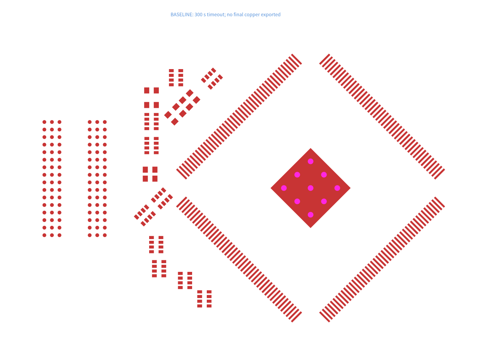
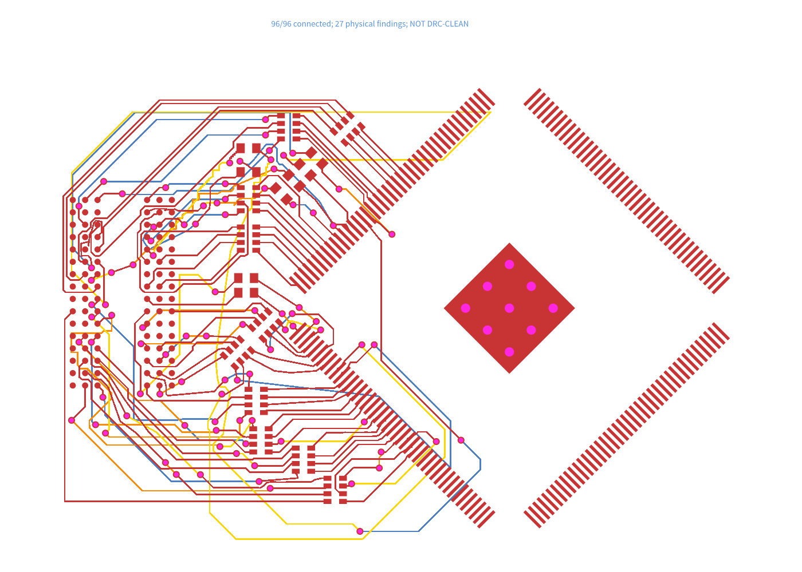

# Native A13 full DDR benchmark output

The bus-solver fix changes A13 from a 300-second timeout with no final copper exported to **96/96 connected DDR paths in 251.4 seconds**. This is routing progress: **27 physical DRC findings remain**, so the full DDR section is not DRC-clean or electrically qualified.

The remaining findings are 15 trace overlaps, 3 pad–trace, 7 via–trace and 2 via–pad clearances. There are no disconnected ports, via-in-pad findings or native pad geometry errors in the completed output. The separate focused 34-path data + DM0 repro has zero physical findings.

Both SVGs come directly from the saved Circuit JSON in the fresh ten-board [benchmark run](https://github.com/tscircuit/core/actions/runs/43958176525), rendered by `circuit-to-svg` using the same viewport. No copper was drawn or edited by hand. The baseline completed 32 data paths internally before timing out in the remaining phase; Core exported no final PCB traces, which is why that full-output baseline image contains pads only.

Core baseline `9c13c5f9132c2b1510856f89c7f220867cc99733`; integration `684ee025f93d2a29a0b70f4a0239c02785dd02f6`; bus-solver fix `aa0c68b66cb0e80d7aa3bc3f11dfd0ce052cc901`. Renderer run [43966099315](https://github.com/tscircuit/core/actions/runs/43966099315). The later Core commits update only the real repro SVGs; production and benchmark inputs are unchanged.

| Baseline: 300 s timeout | Fix: 96/96 connected, 27 physical findings |
| --- | --- |
|  |  |

[Baseline SVG](a13-full-base.svg) · [Fixed routing SVG, with remaining DRC findings](a13-full-head.svg)
