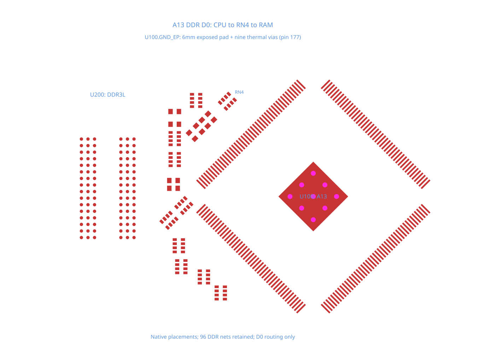

# A13 DDR exposed-pad routing repro

This TSX fixture reconstructs the DDR subsystem of the [Allwinner A13 module](https://github.com/vd-rd/sbc_allwinner_a13/blob/8973c32c64349515da64e268cc03ea8c0789ca2a/hardware/module.kicad_pcb) at commit `8973c32c64349515da64e268cc03ea8c0789ca2a`. The PCB's SHA-256 is `563b646fbd1f021c43a337798882e54ed024c39823280f8b93ddc59c9aa7cb33`.

The fixture keeps U100 (A13), U200 (DDR3L), the DDR resistor arrays and passive endpoints: 20 components, 369 SMD pads, nine thermal plated holes, and 96 named DDR trace paths on the original four-layer board. Placements and copper dimensions are unchanged. Non-circular pads use conservative rectangular bounds. Existing tracks, zones, unrelated circuitry, and power routing are omitted.

U100's native pin 177 / GND consists of a 6 × 6 mm exposed SMD pad rotated 315° and nine 0.9 mm thermal plated holes with 0.6 mm drills. All ten primitives retain the same `portHints`. On the repro branch, reversed Y bounds make core treat them as non-overlapping pins. Their PCB port is missing, nine false pad-clearance errors follow, and core skips autorouting.

`board.tsx` requests D0-D3 through their original series resistor arrays: CPU → RN4/RN1 → RAM. These four data signals require eight copper paths. The remaining 88 DDR paths stay declared and pending. Trace widths, 0.2 mm trace/pad and via/pad clearance, and 0.45/0.3 mm via dimensions come from the source rules. This isolates the exposed-pad routing block; it does not claim a fully routed or timing-qualified DDR interface.

```sh
bun test --timeout 30000 tests/repros/repro-a13-ddr-thermal-pad-routing.test.tsx
```

The repro uses `test.failing` and snapshots core's emitted Circuit JSON before checking the expected connected ground pad and D0 routing. The stacked fix removes the expected-failure marker and keeps the same geometry, connectivity, and physical-clearance assertions.



`source-data.json` was extracted from the pinned native board using the [real DDR dataset](https://github.com/ShiboSoftwareDev/dataset-srj36-real-ddr) and its KiCad parser. It records the source pin, hash, pad geometry, placements, electrical nets, and fabrication rules. `native-a13-part.tsx` converts KiCad-local pad points into core's board frame; no runtime data or pad geometry is patched. The upstream hardware's license is not declared in the dataset (`NOASSERTION`); this fixture does not assign a new license to that hardware.

With the bounds fix, U100.GND_EP has one PCB port shared by all ten primitives, the false clearance errors disappear, and all eight D0-D3 paths route with eight routing vias. The test checks their endpoint connectivity, continuity, and physical clearance against the unchanged native pads. Other DDR signals remain pending.
