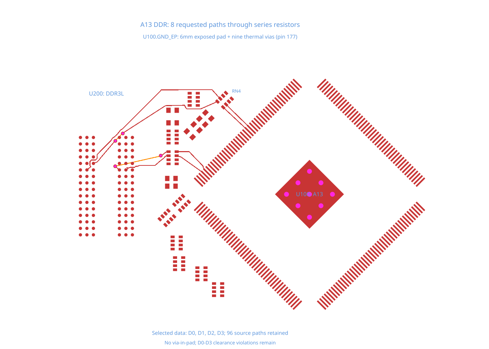

# A13 DDR exposed-pad routing repro

This TSX fixture reconstructs the DDR subsystem of the [Allwinner A13 module](https://github.com/vd-rd/sbc_allwinner_a13/blob/8973c32c64349515da64e268cc03ea8c0789ca2a/hardware/module.kicad_pcb) at commit `8973c32c64349515da64e268cc03ea8c0789ca2a`. The PCB's SHA-256 is `563b646fbd1f021c43a337798882e54ed024c39823280f8b93ddc59c9aa7cb33`.

The fixture keeps U100 (A13), U200 (DDR3L), the DDR resistor arrays and passive endpoints: 20 components, 369 SMD pads, nine thermal plated holes, and 96 named DDR trace paths on the original four-layer board. Placements and copper dimensions are unchanged. Non-circular pads use conservative rectangular bounds. Existing tracks, zones, unrelated circuitry, and power routing are omitted.

U100's native pin 177 / GND consists of a 6 × 6 mm exposed SMD pad rotated 315° and nine 0.9 mm thermal plated holes with 0.6 mm drills. All ten primitives retain the same `portHints`. On the repro branch, reversed Y bounds make core treat them as non-overlapping pins. Their PCB port is missing, nine false pad-clearance errors follow, and core skips autorouting.

`board.tsx` selects data bits through their original series resistor arrays: CPU → resistor array → RAM. All 96 DDR source paths stay declared; only the selected paths are routed. Both cases retain the source trace widths, 0.2 mm trace/pad and via/pad clearance, 0.45/0.3 mm via dimensions, and `isViaInPadAllowed={false}`.

| Case | Selected data bits | Expected output |
| --- | --- | --- |
| Thermal-pad routing control | D0, D1, D4, D7, D8, D9, D12, D13, D15 | 18 connected paths, zero physical errors, zero forbidden vias |
| No-via-in-pad limitation | D0–D3 | Eight connected paths, zero forbidden vias, remaining pad-to-trace clearance errors |

The success test retains the exposed pad's 6 × 6 mm dimensions and 315° rotation, the shared PCB port for all nine thermal holes, endpoint connectivity, continuity, and zero physical-clearance errors. The 18-path selection is the same clean control used in the autorouter's A13 regression.

The separate D0–D3 test preserves the harder case instead of treating it as a clean route. RAM pads F2/F8 are surrounded at 0.8 mm pitch by 0.4 mm pads. With the configured 0.45/0.3 mm vias and 0.2 mm clearance, a drill must be at least 0.35 mm from its own pad center, but neighboring copper clearance restricts a via in that pocket to about 0.30 mm. The earlier output cleared the electrical checks by drilling three RAM pads. The no-via-in-pad fix prevents those holes; seven pad-to-trace errors currently remain. The limitation test checks for those errors, caps them at seven, keeps the other physical checks clean, and labels the remaining clearance violations in its SVG. Error overlays are disabled to keep the native routing readable.

```sh
bun test --timeout 30000 tests/repros/repro-a13-ddr-thermal-pad-routing.test.tsx tests/repros/repro-a13-ddr-no-via-in-pad-limitation.test.tsx
```




`source-data.json` was extracted from the pinned native board using the [real DDR dataset](https://github.com/ShiboSoftwareDev/dataset-srj36-real-ddr) and its KiCad parser. It records the source pin, hash, pad geometry, placements, electrical nets, and fabrication rules. `native-a13-part.tsx` converts KiCad-local pad points into core's board frame; no runtime data or pad geometry is patched. The upstream hardware's license is not declared in the dataset (`NOASSERTION`); this fixture does not assign a new license to that hardware.

With the bounds fix, U100.GND_EP has one PCB port shared by all ten primitives and the false thermal-hole clearance errors disappear. These tests cover selected data paths, not a fully routed or timing-qualified DDR interface; the unselected paths remain pending.
