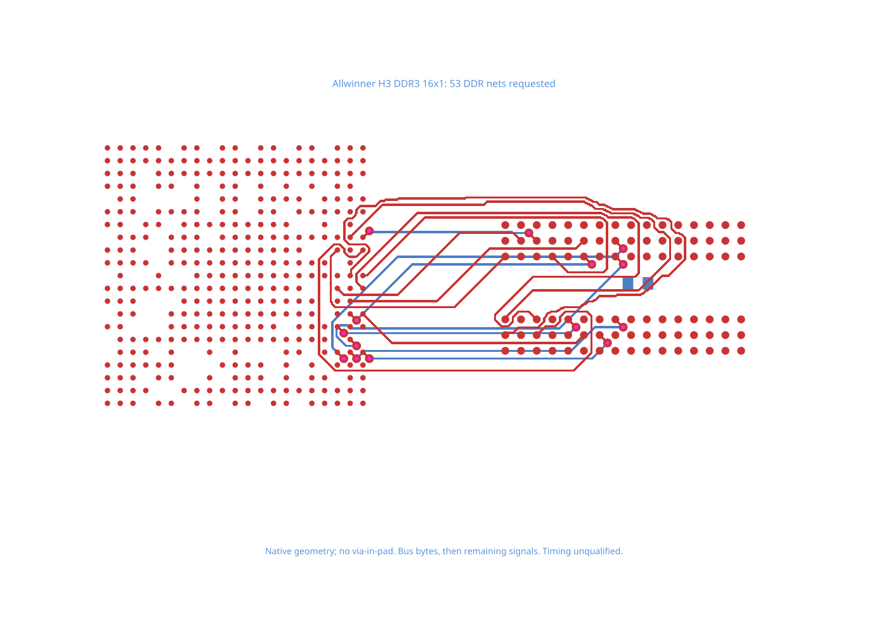

# H3 DDR later-phase failure

The native CPU, RAM and termination resistor come from [allwinner-h3-ddr3-16x1-kicad](https://github.com/hvwyl/allwinner-h3-ddr3-16x1-kicad/blob/02e365b21363a17710e0f96072c0844940495567/project/allwinner-h3.kicad_pcb). The source PCB SHA-256 is `4a1f99d157a4ed5dc15b2dff2fed9f3765226296c1da3930cdd00413254509bb`.

This is the same H3 circuit as the pinned `@tscircuit/core-ddr-benchmark` dataset. It keeps native placements, pad geometry, two copper layers, fabrication dimensions and all 53 selected DDR signals. Existing copper is removed for a fresh routing attempt; timing and impedance are not qualified. The upstream project does not declare a license; the source record retains `NOASSERTION`.

Both eight-bit data groups complete before the remaining phase fails. The reproduction shows whether Core keeps that completed copper while still reporting the failure.

```sh
bun test tests/repros/repro-h3-ddr-later-phase-failure.test.tsx
```


