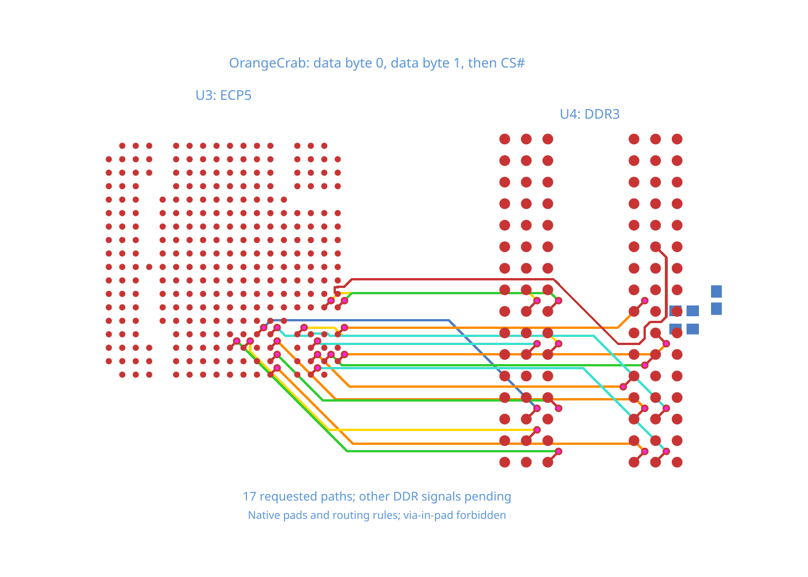

# OrangeCrab data-to-chip-select handoff

The fixture reuses the pinned native footprints and connectivity from
[`orangecrab-ddr-clock`](../orangecrab-ddr-clock/README.md): ECP5, DDR3,
R5/R13/C27 and all 387 SMD pads. All 51 DDR/termination source paths stay declared.

It requests D0–D7, then D8–D15, then CS# (U3.A12 to U4.L2). The byte phases use
bus lanes; chip-select uses the regular autorouter. The original widths,
0.089 mm clearance, six layers and 0.28/0.15 mm vias are retained, with via-in-pad
forbidden. The other signals and power routing remain pending; this is not a
timing-qualified DDR interface.

Both byte phases finish. Core then represents their fixed copper with rectangles
for the chip-select phase. The diagonal trace rectangles are too wide and the
regular router reports chip-select unreachable, leaving no published traces.

The regression requests the same data-first phase order, verifies all 17 paths
are connected without moving the completed bytes, and checks physical clearance.

