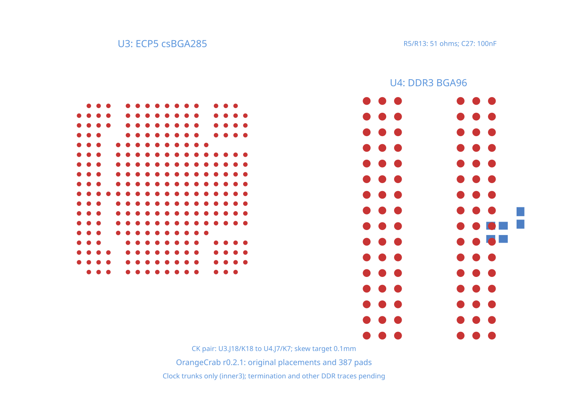
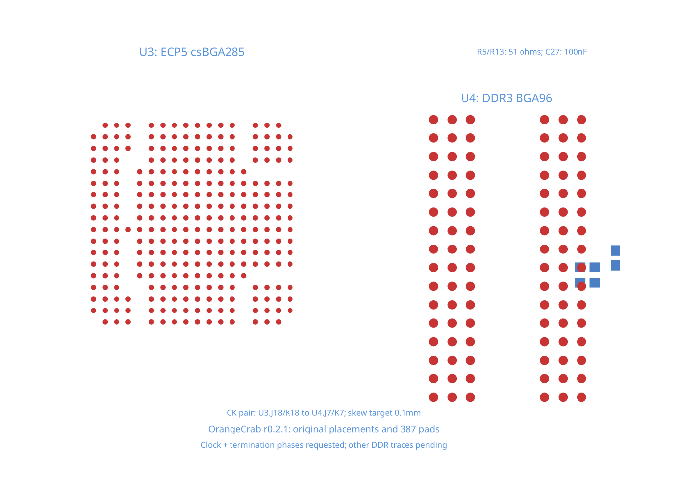

# OrangeCrab DDR clock reproduction

This is the DDR signal subsystem from [OrangeCrab rev 0.2.1](https://github.com/orangecrab-fpga/orangecrab-hardware/blob/c511d569fe2af39467041f888bc231020f40c6ac/hardware/orangecrab_r0.2.1/OrangeCrab.kicad_pcb), rendered and routed through TSX and core.

The fixture keeps U3 (LFE5U-25F-8MG285C), U4 (MT41K64M16TW-107_J-TR), R5/R13 (51 ohms), C27 (100nF), their original placements, six-layer board, and all 387 copper pads. All 51 selected DDR electrical nets remain declared as 54 trace paths. The clock trunks and termination branches share their original electrical nets.

`board.tsx` requests the two CPU-to-RAM clock trunks first. `routeRemaining={false}` leaves the termination taps and other DDR signals pending. This isolates the clock-selection bug without removing those connections. The 0.1 mm planar skew target is an experimental routing constraint, not an electrical timing or impedance qualification.

## Reproduce

```sh
bun test tests/repros/repro-orangecrab-ddr-clock-trunks.test.tsx
bun test tests/repros/repro-orangecrab-ddr-clock-termination.test.tsx
```

On the repro branch, the trunk test is marked `test.failing`: core expands each named trunk to every branch on its net and rejects the differential pair before starting a solver. The expected-failure marker allows CI to retain the reproduction. The stacked fix removes that marker and runs the same routing, endpoint, skew, and physical-clearance assertions.

The snapshot renders core's published Circuit JSON with `toMatchPcbSnapshot`.



## Remaining failure

The second test enables `routeTerminations` on the same circuit. The clock phase can complete after the fix, but the next termination phase fails at a BGA routing region. Core publishes zero final traces when that later phase fails. This test and its snapshot preserve that limitation; completing the first clock phase does not establish a routed DDR subsystem.



## Source and conversion

The upstream PCB is pinned at commit `c511d569fe2af39467041f888bc231020f40c6ac`, SHA-256 `4597f3ac08e21c09253b27ca1b9e26aaf3c3d3e2147b6c0d79c0dc6aa555e201`. `source-data.json` records the native footprints, pad numbers, dimensions, placements, net membership, board origin, and fabrication dimensions. Positions are in millimeters.

`source-part.tsx` converts KiCad footprint-local points (+X right, +Y down) to core-local points (+X right, +Y up) with a composed transform. The 381 BGA balls remain exact circles. The six rounded rectangular passive pads use conservative rectangular bounds. Existing traces, vias, zones, unrelated circuitry, and power/ground routing are outside this fresh signal-routing reproduction.

The hardware data is derived from the OrangeCrab project, licensed under [CERN OHL v1.2](LICENSE.hardware.txt), as stated in its [upstream README](https://github.com/orangecrab-fpga/orangecrab-hardware/blob/c511d569fe2af39467041f888bc231020f40c6ac/README.md). This extracted TSX representation and routing scope modify the original hardware representation; the original design remains available at the pinned link above.
